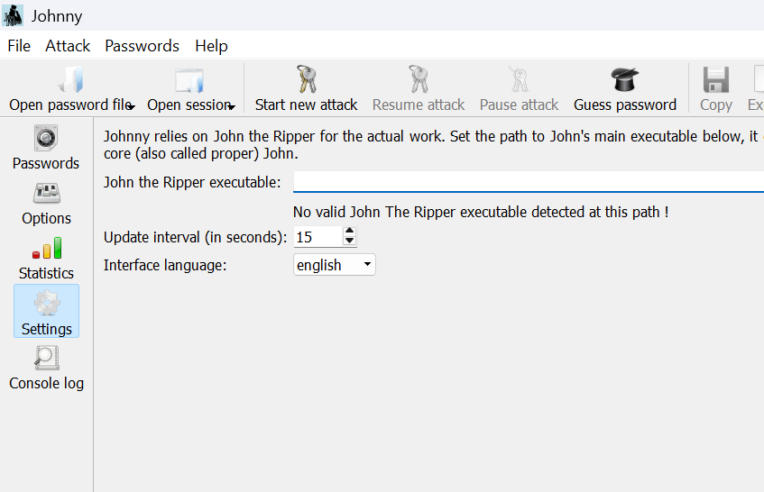
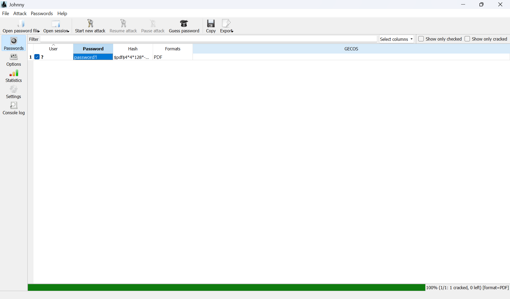
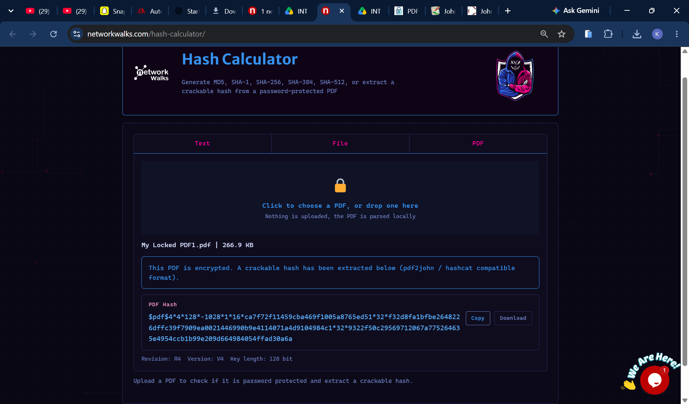
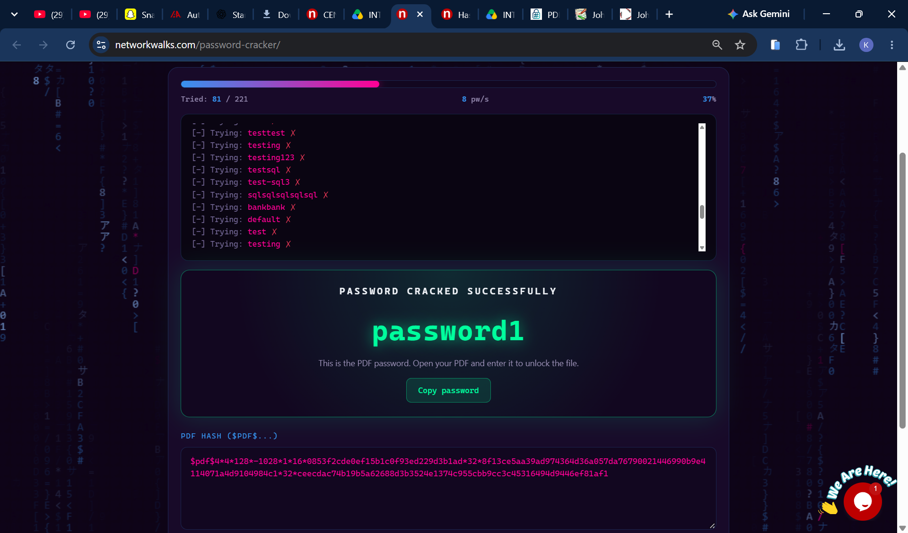

# PASSWORD CRACKING REPORT
## JOHN THE RIPPER (JTR) & NETWORKWALKS TOOLS

**W3-PM1 | W3-PM2 | CYBERSECURITY | NETWORKWALKS**

---

## Project Information

| **Field** | **Details** |
|---|---|
| **Project** | Password Cracking |
| **Tools Used** | John the Ripper, Johnny GUI, Networkwalks Hash Calculator and Password Cracker |
| **Operating System** | Windows |
| **Target** | Course-provided password-protected PDF |
| **Purpose** | Educational password security assessment |

---

# 1. Introduction

This project covers two practical modules from Week 3 of my Cybersecurity & Ethical Hacking training at Networkwalks.

The activities focused on understanding how password-protected files are secured, how password hashes are used, and how password recovery tools can be applied in authorised security testing.

The exercises provided hands-on exposure to both traditional password auditing software and browser-based password security tools.

# 2. Tools Used

| **Tool** | **Purpose** |
|---|---|
| John the Ripper (JTR) | Password auditing and recovery. |
| Johnny GUI | Graphical interface for John the Ripper. |
| Networkwalks Hash Calculator | Extracting password hash information from a protected PDF. |
| Networkwalks Password Cracker | Testing the extracted hash in the assigned lab exercise. |
| Windows | Operating system used for the practical activities. |

# 3. Activities Performed

## 3.1 W3-PM1: Password Cracking with John the Ripper

In this module, I worked with John the Ripper and its graphical interface, Johnny, to understand password recovery for a course-provided protected PDF.

**Key activities:**

- Installed and configured John the Ripper.
- Installed and configured Johnny GUI.
- Worked with password hash information extracted from the assigned PDF.
- Performed the assigned password recovery exercise.
- Verified the result using the provided PDF.

**Key Learning:** Understanding how password auditing tools evaluate password strength and why weak passwords can create security risks.

## 3.2 W3-PM2: Password Cracking with Networkwalks Tools

In this module, I used Networkwalks' browser-based tools to understand the password recovery process.

**Tools used:**

- Networkwalks Hash Calculator.
- Networkwalks Password Cracker.

**Key activities:**

- Obtained the course-provided protected PDF.
- Used the Hash Calculator to obtain its hash information.
- Worked with the Password Cracker as part of the assigned exercise.
- Verified the result using the protected PDF.

**Key Learning:** Understanding the relationship between password hashes, password recovery and the importance of password complexity.

# 4. Key Concepts Learned

| **Concept** | **Explanation** |
|---|---|
| Password Hashing | A one-way process that converts a password into a hash value. |
| Encryption | A two-way process that allows information to be recovered using the appropriate key. |
| Password Cracking | Testing password candidates against stored password hashes. |
| John the Ripper | A widely used password auditing tool. |
| Password Strength | How resistant a password is to guessing and recovery attempts. |

# 5. Security Recommendations

1. Use long and complex passwords.
2. Avoid common passwords and predictable combinations.
3. Use unique passwords for different accounts.
4. Enable multi-factor authentication wherever possible.
5. Use a reputable password manager.
6. Regularly review password security practices.
7. Use secure password hashing methods when developing applications.
8. Conduct password security assessments only within authorised environments.

# 6. Conclusion

Week 3 provided an opportunity to explore password security through two practical exercises.

Working with John the Ripper, Johnny GUI and Networkwalks' password tools helped me understand the role of password auditing in cybersecurity.

One of my major takeaways is that password security goes beyond simply creating a password. Understanding how passwords are stored, how hashes work and how weak passwords can be exposed is essential when protecting digital information.

This practical experience has strengthened my understanding of password security and the importance of using strong authentication practices.

# 7. Evidence Collected

Screenshots documenting the practical activities are included below.

## W3-PM1: Password Cracking with John the Ripper

### Figure 1: John the Ripper Setup

### Figure 2: Johnny GUI Configuration

### Figure 3: Practical Exercise

## W3-PM2: Password Cracking with Networkwalks Tools

### Figure 4: Networkwalks Hash Calculator

### Figure 5: Networkwalks Password Cracker

### Figure 6: Practical Verification

---
